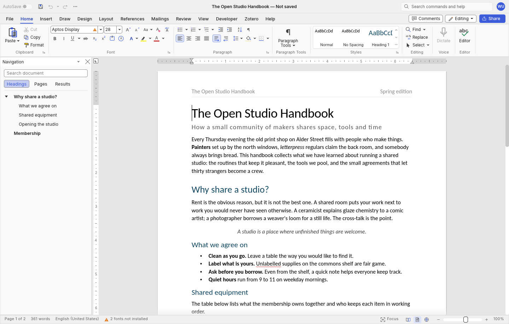

<p align="center">
  
</p>

<h1 align="center">WordKu</h1>

<p align="center">
  Pengolah kata sumber terbuka untuk menulis dan mendesain dokumen.<br>
  Membuka dan menyimpan .docx, berjalan luring, tanpa akun, tanpa telemetri.
</p>

<p align="center">
  
</p>

> **Status:** belum ada rilis bernama WordKu. Rilis v1.0.0 sampai v1.0.2 di halaman
> [Releases](https://github.com/andriyanto/wordku/releases) masih bernama WordCraft. Installer
> WordKu akan muncul di sana setelah rilis WordKu pertama. Sampai saat itu, WordKu bisa dibangun
> dari kode sumber (lihat [Membangun dari kode sumber](#membangun-dari-kode-sumber)).

## Apa yang bisa dilakukan

- **Menulis.** Mengetik cepat dengan IME, AutoCorrect, tanda kutip pintar, daftar otomatis,
  cari dan ganti (juga dengan regex), urungkan dan ulangi.
- **Format.** Font, ukuran, tebal/miring/garis bawah, warna, sorotan, jarak huruf, Format Painter,
  perataan, indentasi (bisa diseret di penggaris), spasi, tab, border, dan shading paragraf.
- **Styles dan daftar.** Galeri Styles dengan pratinjau langsung, panel Styles, style set, tema;
  bullet, penomoran, dan daftar bertingkat.
- **Tabel.** Sisipkan dari kisi, gabung dan pecah sel, style tabel, baris judul yang berulang di
  tiap halaman, urutkan, rumus.
- **Halaman.** Margin, orientasi, ukuran kertas, kolom, pemisah halaman dan bagian, header dan
  footer, nomor halaman, watermark, border halaman, nomor baris, drop cap, pemenggalan kata.
- **Gambar dan diagram.** Gambar (ubah ukuran, potong, warnai ulang, hapus latar), kotak teks,
  dan lebih dari 80 bentuk dengan gagang untuk mengubah proporsinya; konektor yang menempel ke
  bentuk, berbelok menghindari bentuk lain, dan bisa diberi label; banyak gambar bisa dipilih,
  digeser, diratakan, diubah ukurannya, dan diputar bersama.
- **Referensi.** Daftar isi, catatan kaki dan akhir, sitasi dan daftar pustaka (APA, MLA,
  Chicago, IEEE), keterangan gambar, rujukan silang, indeks.
- **Tinjauan.** Ejaan dan tata bahasa, tesaurus, jumlah kata, komentar, lacak perubahan,
  bandingkan dokumen, batasi penyuntingan, pemeriksa aksesibilitas.
- **Surat massal.** Mail merge dari CSV, amplop, dan label.
- **Tampilan.** Print layout, web layout, draft, mode baca, zoom, panel Navigation, mode gelap.
  Antarmuka tersedia dalam bahasa Inggris dan puluhan bahasa lain; secara bawaan mengikuti bahasa
  sistem.
- **Berkas.** Membaca dan menulis .docx, .odt, .rtf, .html, .md, .tex dan .txt; membuka .doc
  97-2003; ekspor PDF dengan teks yang bisa dipilih, tautan, dan bookmark.

Gambaran jujur per bidang, termasuk yang belum ada, ada di [ROADMAP.md](ROADMAP.md) dan
[daftar fitur](docs/parity-checklist.md).

## Cara WordKu memperlakukan berkas Anda

- **Simpan dengan aman.** Berkas ditulis ke berkas sementara lebih dulu, lalu menggantikan yang
  lama. Kalau penyimpanan gagal, berkas asli tetap utuh.
- **Salinan pemulihan.** Dokumen yang belum disimpan dijaga dalam salinan pemulihan, dan bisa
  dibuka lagi setelah aplikasi tertutup tiba-tiba (**File › Recover**).
- **Bekerja luring.** Ejaan, tata bahasa, dan fitur lainnya berjalan tanpa internet. Gambar yang
  hanya ditautkan oleh dokumen tidak diunduh.

## Privasi

WordKu tidak punya akun, telemetri, analitik, atau laporan crash. Dokumen dan berkas log tetap di
komputer Anda dan tidak dikirim ke mana pun.

Aplikasi hanya terhubung ke jaringan dalam keadaan berikut:

| Kapan | Ke mana | Apa yang dikirim |
|---|---|---|
| Setiap kali aplikasi desktop dimulai, dan saat memilih **Help ▸ Check for Updates** | GitHub (`api.github.com`): daftar rilis `andriyanto/wordku` | Satu permintaan daftar itu. Tidak ada data tentang Anda, komputer, atau dokumen Anda. Seperti permintaan web lain, GitHub melihat alamat IP Anda. |
| Saat menekan **Download** di pemberitahuan pembaruan, atau **Help ▸ Download Latest…** | Peramban membuka halaman rilis di GitHub. Aplikasi tidak mengunduh atau memasang apa pun sendiri | Yang dikirim peramban Anda. |
| Saat mengeklik **Install** atau **Add a language…** untuk paket bahasa atau font. Unduhan mati sampai Anda melakukannya | GitHub (`github.com`, `raw.githubusercontent.com`) dan jsDelivr (`cdn.jsdelivr.net`) | Permintaan unduhan itu. |
| Saat mengeklik tautan di dokumen atau di Help | Peramban membuka alamatnya | Yang dikirim peramban Anda. |

Integrasi Zotero hanya berbicara dengan aplikasi Zotero di komputer yang sama (`127.0.0.1`), Read
Aloud memakai program suara di komputer yang sama, dan kanal kontrol serta server MCP hanya
berjalan bila Anda menjalankannya sendiri. Pengelola repo ini tidak menerima data apa pun dari
aplikasi.

## Unduhan dan pemasangan

Setelah rilis WordKu pertama terbit, semua berkasnya ada di
[rilis terbaru](https://github.com/andriyanto/wordku/releases/latest). `<ver>` adalah nomor versi,
dan `SHA256SUMS.txt` memuat checksum setiap berkas.

| Sistem | Berkas |
|---|---|
| Windows x64 | `wordku-<ver>-windows-x64.msi` (installer) atau `wordku-<ver>-windows-x64-portable.zip` |
| Windows ARM64 (Snapdragon) | `wordku-<ver>-windows-arm64.msi` atau `wordku-<ver>-windows-arm64-portable.zip` |
| macOS (Apple silicon dan Intel) | `wordku-<ver>-macos-universal.dmg`; baris perintah: `wordku-cli-<ver>-macos-universal.zip` |
| Linux x86_64 dan aarch64 | `wordku-<ver>-linux-<arch>.AppImage`, `.deb`, `.rpm`, atau `.tar.gz` |

Installer Windows memasang WordKu ke folder `Produktivitas\WordKu`:

| Jenis pemasangan | Folder |
|---|---|
| Hanya untuk saya (bawaan, tanpa hak administrator) | `%LOCALAPPDATA%\Programs\Produktivitas\WordKu` |
| Untuk semua pengguna | `C:\Program Files\Produktivitas\WordKu` |

WordKu adalah aplikasi tersendiri: ia bisa terpasang berdampingan dengan WordCraft dan tidak
memakai pengaturan WordCraft. Pengaturan dan log WordKu ada di `%APPDATA%\WordKu` (Windows),
`~/Library/Application Support/WordKu` (macOS), atau `~/.config/wordku` (Linux).

Berkas rilis repo ini **belum ditandatangani (code signing)**, jadi Windows SmartScreen dan macOS
Gatekeeper akan memberi peringatan saat pertama dibuka. Periksa unduhan dengan `SHA256SUMS.txt`.
Aplikasi memberi tahu bila ada versi baru, tetapi tidak pernah memasangnya sendiri: Anda yang
mengunduh dan menjalankannya.

**Kalau aplikasi tidak terbuka di Windows:** coba renderer lain lewat PowerShell, dari folder
tempat `wordku.exe` berada:

```powershell
$env:WGPU_BACKEND = "vulkan"
& .\wordku.exe
Remove-Item Env:WGPU_BACKEND
```

## Membangun dari kode sumber

Perlu Rust versi terbaru (stable).

```sh
git clone https://github.com/andriyanto/wordku
cd wordku
cargo run --release -p wordcraft -- --sample        # aplikasi desktop dengan dokumen contoh
cargo run --release -p wordcraft -- laporan.docx    # membuka dokumen
```

Terjemahan antarmuka serta data ejaan dan pemenggalan kata berasal dari
[craft-i18n](https://github.com/storytold/craft-i18n). Tanpanya, antarmuka hanya berbahasa
Inggris. Untuk menyertakannya:

```sh
git clone https://github.com/storytold/craft-i18n ../craft-i18n
git -C ../craft-i18n checkout "$(cat craft-i18n.rev)"
CRAFT_I18N_DIR="$PWD/../craft-i18n" cargo run --release -p wordcraft -- --sample
```

Paket dan pustaka di dalam kode masih bernama `wordcraft` dan `wordcraft-*`, begitu juga variabel
lingkungan `WORDCRAFT_*`. Itu nama internal dan tidak tampil ke pengguna; program yang dihasilkan
bernama `wordku` dan `wordku-cli`. `cargo xtask ci` menjalankan format, clippy, tes, pemeriksaan
atribusi aset, dan build wasm.

## Baris perintah dan agen AI

Semua tindakan di WordKu adalah perintah bernama, sehingga bisa dijalankan tanpa antarmuka grafis
lewat `wordku-cli`:

```sh
wordku-cli convert laporan.docx laporan.pdf      # docx, pdf, odt, rtf, html, md, tex, txt, png
wordku-cli text laporan.docx                     # teks polos
wordku-cli inspect laporan.docx                  # struktur dokumen dalam JSON
wordku-cli run --template sample \
  --cmd 'select.text={"text":"Membership"}' --cmd format.bold --save hasil.docx
```

`wordku-cli mcp` menjalankan server MCP untuk agen AI. Secara bawaan, agen hanya bisa membaca dan
menulis berkas di folder tempat server dimulai. Untuk mengendalikan aplikasi yang sedang berjalan,
mulai aplikasinya dengan `wordku --control 7981`, lalu jalankan
`wordku-cli mcp --connect 127.0.0.1:7981`. Rinciannya ada di [docs/mcp.md](docs/mcp.md) dan
[docs/control-protocol.md](docs/control-protocol.md).

## Bantuan dan laporan masalah

Laporkan masalah atau usulkan perbaikan di
[Issues](https://github.com/andriyanto/wordku/issues). Sertakan versi WordKu (**Help › About
WordKu**), sistem operasi, langkah untuk mengulang masalahnya, dan berkas log `logs/wordku.log`
dari folder pengaturan di atas. Jangan melampirkan dokumen yang berisi data pribadi.

## Kebijakan code signing

**Status: berkas rilis repo ini belum ditandatangani.** Installer dan program Windows tidak
bertanda tangan, dan build macOS hanya bertanda tangan ad hoc tanpa notarisasi.

Proyek ini mengajukan code signing gratis untuk proyek sumber terbuka ke SignPath Foundation. Bila
diterima, kalimat berikut berlaku untuk build Windows, dan status di atas akan dihapus:

> Free code signing provided by [SignPath.io](https://about.signpath.io), certificate by
> [SignPath Foundation](https://signpath.org).

Cara rilis dibuat, bertanda tangan atau tidak:

- Setiap perubahan masuk ke `main` lewat pull request. Banyak di antaranya disiapkan dengan agen
  AI (Claude), dan commit-nya menyebutkannya; pengelola meninjau dan menggabungkan masing-masing.
- Berkas rilis dibangun oleh GitHub Actions di repo ini dari commit yang ada di `main`
  ([`.github/workflows/release-unsigned.yml`](.github/workflows/release-unsigned.yml)). Tidak ada
  yang dibangun di komputer pribadi lalu diterbitkan.
- Rilis tetap berupa draf sampai pengelola memeriksa dan menerbitkannya.

Peran: committer, peninjau, dan penyetuju adalah [@andriyanto](https://github.com/andriyanto).

## Asal-usul dan lisensi

WordKu adalah versi modifikasi dari [WordCraft](https://github.com/storytold/wordcraft) dan
dikembangkan sebagai proyek tersendiri di repo ini. WordKu tidak dibuat, disponsori, atau
didukung oleh ArtCraft Team; nama dan logo ArtCraft adalah merek dagang mereka dan tidak dipakai
di sini. Perubahan teknis dibanding proyek asal dicatat di
[docs/technical-note-changes.md](docs/technical-note-changes.md).

Kode berlisensi ganda, pilih salah satu:

- [MIT](LICENSE-MIT)
- [Apache License 2.0](LICENSE-APACHE)

Hak cipta (c) 2026 ArtCraft Team dan para kontributor WordCraft; perubahan untuk WordKu: hak cipta
(c) 2026 andriyanto dan para kontributor WordKu. Pemberitahuan yang diwajibkan lisensi pihak
ketiga ada di [NOTICE](NOTICE), dan setiap aset beserta pembuat, sumber, dan lisensinya ada di
[ATTRIBUTION.md](ATTRIBUTION.md). Ikon WordKu dirancang oleh andriyanto; huruf pada ikon adalah
garis luar DejaVu Sans Condensed Bold (lisensi Bitstream Vera).
